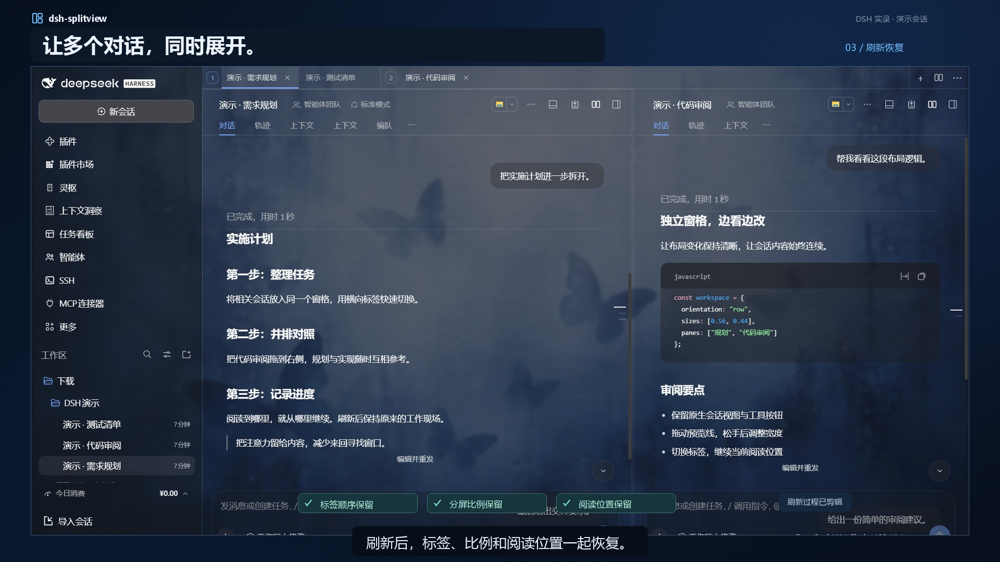

# dsh-splitview

让多个 DSH 对话并排展开，把来回切换变成同时推进。

**[▶ 观看 30 秒演示](https://github.com/yzyg6/dsh-splitview/blob/main/promo/dsh-splitview-native-1080p.mp4)** · [下载视频](https://github.com/yzyg6/dsh-splitview/releases/download/v0.2.0/dsh-splitview-native-1080p.mp4) · [下载插件](https://github.com/yzyg6/dsh-splitview/releases/latest)

实录使用专用演示会话，带中文字幕。

## 能做什么

- **拖拽分屏**：把侧栏会话拖到对话区边缘，即可左右或上下并排查看；拖动分隔条调整大小。
- **横向标签**：快速切换会话，拖动排序、跨窗格移动，随时关闭不需要的标签。
- **继续阅读**：分别记住每个标签的阅读位置，刷新或重启 DSH 后恢复标签顺序、分屏比例和阅读进度。
- **熟悉的界面**：保留 DSH 的工具按钮、视图切换和历史跳转；加载失败时可以直接重试。

## 开始使用

1. 在[发布页](https://github.com/yzyg6/dsh-splitview/releases/latest)下载插件 ZIP 并解压。
2. 把解压后的文件夹路径发给 DSH，告诉它：「请安装这个本地插件。」
3. 安装后，从左侧拖入一个会话，开始分屏工作。

在 DSH 设置的「分屏视图」中，可以开关插件、调整窗格数量或重置布局。

[更新记录](CHANGELOG.md) · [反馈问题](https://github.com/yzyg6/dsh-splitview/issues) · [MIT 许可](LICENSE)
