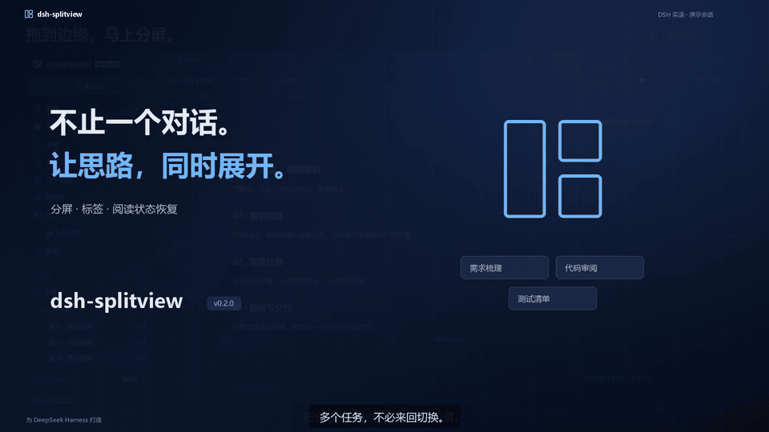

# dsh-splitview

让多个 DSH 对话并排展开，把来回切换变成同时推进。

**[下载 30 秒完整视频](https://github.com/yzyg6/dsh-splitview/releases/download/v0.2.0/dsh-splitview-native-30s.mp4)** · [下载封面](https://github.com/yzyg6/dsh-splitview/releases/download/v0.2.0/dsh-splitview-native-cover.png) · [下载插件](https://github.com/yzyg6/dsh-splitview/releases/latest)

实录使用专用演示会话，带中文字幕。

## 能做什么

- **拖拽分屏**：把侧栏会话拖到对话区边缘，即可左右或上下并排查看；拖动分隔条调整大小。
- **横向标签**：快速切换会话，拖动排序、跨窗格移动，随时关闭不需要的标签。
- **继续阅读**：分别记住每个标签的阅读位置，刷新或重启 DSH 后恢复标签顺序、分屏比例和阅读进度。
- **熟悉的界面**：保留 DSH 的工具按钮、视图切换和历史跳转；加载失败时可以直接重试。
- **紧凑侧栏**：56 像素图标栏固定最多 3 个常用插件，其余收进“更多”浮层。工作区采用分组留白、会话缩进和更清晰的文字层级。
- **自己决定顺序**：「更多 → 管理常用插件」中可选择、取消固定和拖拽排序；图标栏也可直接拖动，或使用 Alt + ↑ / ↓。使用次数不会改变位置，只有主动点击「按使用频率推荐」才会重新选择。
- **工作区独立入口**：点击图标栏的文件夹按钮，或按 Ctrl+B（macOS 为 ⌘B），展开或收起工作区列表；图标随状态变化并高亮，插件栏继续保留，再次展开恢复原宽度。

## 开始使用

1. 在[发布页](https://github.com/yzyg6/dsh-splitview/releases/latest)下载插件 ZIP 并解压。
2. 把解压后的文件夹路径发给 DSH，告诉它：「请安装这个本地插件。」
3. 安装后，从左侧拖入一个会话，开始分屏工作。

在 DSH 设置的「分屏视图」中，可以开关插件、调整窗格数量或重置布局。
「紧凑侧栏」可单独关闭，恢复 DSH 原来的左侧栏；固定顺序和使用次数只保存在本机。

[更新记录](CHANGELOG.md) · [反馈问题](https://github.com/yzyg6/dsh-splitview/issues) · [MIT 许可](LICENSE)
